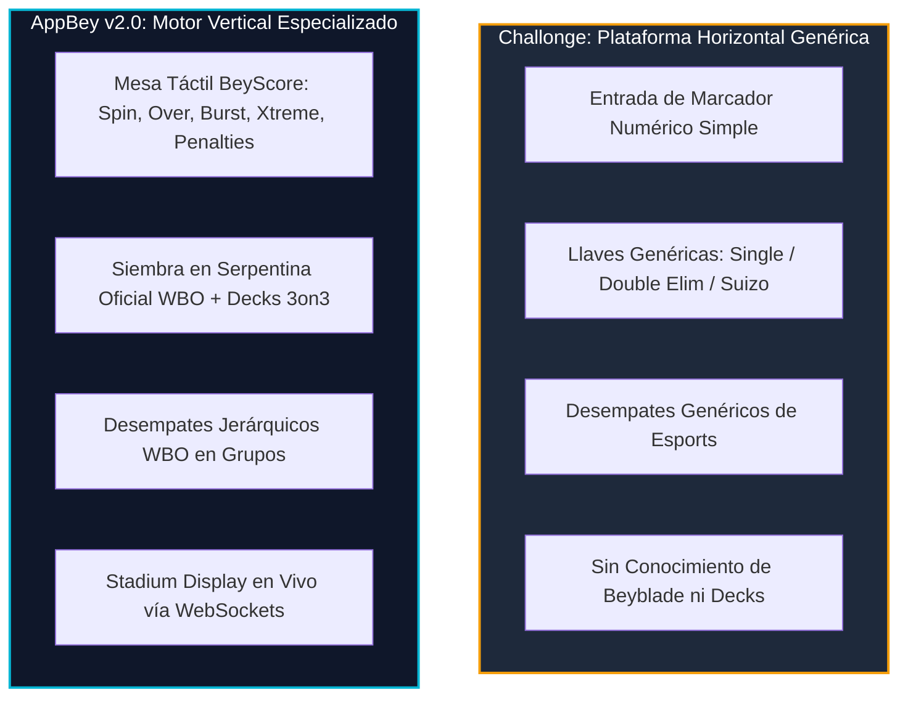
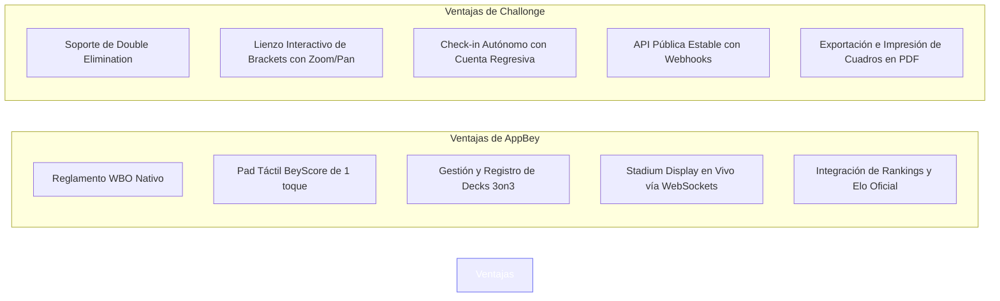

# AUDITORÍA COMPARATIVA: APPBEY v2.0 vs. CHALLONGE
## Creación, Diseño de Torneos y Sistemas de Arbitraje en la Escena Competitiva de Beyblade X
**Marco de Referencia:** Normativas de Torneos Oficiales de la World Beyblade Organization (WBO) & Estándares Esports  
**Objetivo:** Análisis comparativo de capacidades, ventajas competitivas, brechas funcionales y oportunidades de arquitectura  

---

## 1. RESUMEN EJECUTIVO: FILOSOFÍA DE AMBAS PLATAFORMAS

La organización de torneos competitivos de **Beyblade X** históricamente ha dependido de **Challonge** como estándar *de facto* para la gestión de llaves y cruces. Sin embargo, Challonge es una plataforma de propósito general (*general-purpose tournament bracket software*), lo que obliga a los organizadores y jueces a recurrir a soluciones analógicas o herramientas externas (hojas de cálculo de desempate, marcadores físicos manuales o planillas de papel).

**AppBey v2.0** surge como una solución vertical (*purpose-built esports software*), diseñada desde cero con la reglamentación WBO, mecánicas de arbitraje táctil oficial (**BeyScore**) y dinámicas específicas del meta competitivo (Decks 3on3, tipos de finish y pantallas para proyectores).



---

## 2. COMPARATIVA DE CREACIÓN Y DISEÑO DE TORNEOS

A continuación se desglosan las características disponibles para la configuración, estructura de llaves y gestión de participantes en ambos ecosistemas.

### Matriz Comparativa: Configuración de Torneo

| Característica / Flujo | Challonge (Estándar Global) | AppBey v2.0 (Motor Beyblade) | Veredicto & Ventaja |
| :--- | :--- | :--- | :--- |
| **Formatos Disponibles** | Single Elim, Double Elim, Round Robin, Suizo, Two-Stage (Grupos + Playoffs), Free-for-all. | Single Elim, Round Robin, Suizo, Two-Stage (Grupos + Single Elim). | **Gana Challonge:** Soporta **Double Elimination** (crucial para torneos con fase de perdedores). |
| **Distribución de Grupos** | Asignación secuencial o manual; soporte de siembra personalizada. | **Siembra en Serpentina (Serpentine Seeding)** automática: $1 \to A, 2 \to B, 3 \to B, 4 \to A...$ | **Gana AppBey:** Serpentina nativa balancea matemáticamente el nivel de habilidad entre grupos. |
| **Emparejamiento Suizo** | Algoritmo estándar con detección de revanchas y cálculo Buchholz / Sonneborn-Berger. | Suizo con Buchholz automático; algoritmo voraz con fallback de revancha forzada si el roster es impar. | **Empate técnico:** Challonge ofrece mayor madurez ante grafos complejos; AppBey lo integra con Elo nativo. |
| **Desempates en Grupos** | Sets ganados, diferencia de juegos, puntos anotados. Requiere ajustes manuales para reglas complejas. | **Criterio Oficial WBO:** Victorias $\to$ Diferencia de Puntos $\to$ Enfrentamiento Directo $\to$ Puntos a favor $\to$ Seed. | **Gana AppBey:** Resuelve la matemática de desempate de la WBO sin intervención del juez. |
| **Registro de Decks 3on3** | ❌ No existe. Se debe gestionar en hojas de cálculo externas o Google Forms. | ✅ **Nativo:** Validación de Decks 3on3 por Blader, historial de combos e inspección en vivo. | **Gana AppBey (Ventaja Exclusiva):** Fundamental en Beyblade X moderno. |
| **Participantes Invitados (Walk-in)** | ✅ Soporta añadir participantes sin cuenta de Challonge. | ✅ Soporta Bladers invitados registrados en mesa con generación de avatar Dicebear y credenciales locales. | **Empate:** Ambos permiten gestionar jugadores presenciales sin cuenta previa. |
| **Check-in Automatizado** | ✅ Ventana temporal configurable con cuenta regresiva y purga de ausentes (*no-shows*). | ⚠️ Check-in manual individual o masivo por el organizador; sin auto-drop por temporizador. | **Gana Challonge:** El auto-checkin ahorra hasta 30 minutos a los jueces antes de comenzar. |
| **Visualizador de Llaves (Bracket UI)**| ✅ Lienzo interactivo fluido con zoom, paneo, impresión y exportación en iframe/imagen. | ⚠️ Renderizado en árbol DOM estático; legible pero sin controles de paneo/zoom en torneos grandes (>64). | **Gana Challonge:** Interfaz visual de brackets ampliamente superior en ergonomía y escala. |

---

## 3. COMPARATIVA DE ARBITRAJE Y GESTIÓN DE COMBATES (REFEREEING & SCORING)

El arbitraje es el área donde la brecha entre una herramienta genérica y una herramienta especializada se vuelve más dramática.

```
  ┌────────────────────────────────────────────────────────────────────────────────────────┐
  │                   EXPERIENCIA DE ARBITRAJE EN MESA: COMPARATIVA                        │
  ├───────────────────────────────────┬────────────────────────────────────────────────────┤
  │ Challonge (Flujo Genérico)        │ AppBey v2.0 (Flujo BeyScore Táctil)                │
  ├───────────────────────────────────┼────────────────────────────────────────────────────┤
  │ 1. Árbitro abre web completa.     │ 1. Árbitro entra a lobby `/referee` en móvil.      │
  │ 2. Localiza combate en la llave.  │ 2. Selecciona su grupo o mesa asignada.            │
  │ 3. Espera fin del combate.        │ 3. Presiona botones de 1 toque conforme ocurren:   │
  │ 4. Cuenta mentalmente los puntos. │    - Spin Finish (+1 pt)                           │
  │ 5. Escribe teclado: "4" y "2".    │    - Over Finish (+2 pts)                          │
  │ 6. Guarda.                        │    - Burst Finish (+2 pts)                         │
  │                                   │    - Xtreme Finish (+3 pts)                        │
  │                                   │    - Warnings / Self KO (+1 pt)                    │
  │                                   │ 4. Sistema detecta meta (4 pts o 2 sets) y cierra. │
  │                                   │ 5. Deshacer (Undo) instantáneo ante reclamo.       │
  │                                   │ 6. Acta detallada con tipos de finalización.       │
  └───────────────────────────────────┴────────────────────────────────────────────────────┘
```

### Análisis Detallado de Características de Arbitraje

#### 1. Pad Táctil Oficial BeyScore vs. Input Numérico Plano
- **En Challonge:** El árbitro únicamente cuenta con dos cajas de texto: `Score 1` y `Score 2`. No queda ningún registro de cómo se consiguieron los puntos. Se pierden datos vitales para estadísticas de rendimiento (¿qué porcentaje de victorias fueron por *Burst* o por *Xtreme*?, ¿qué Beyblades generan más *Over Finish*?).
- **En AppBey:** El árbitro dispone de una botonera de alta visibilidad, con esquinas diferenciadas (Corner Azul vs. Corner Rojo), botones de 1 toque con la puntuación oficial reglamentada (+1, +2, +3), soporte de penalizaciones WBO (tarjetas/warnings) y modo de puntuación manual rápida (`+/-`).

#### 2. Soporte Oficial de Sets en Eliminación Directa
- **Reglamento WBO:** En fases finales de Eliminación Directa, los combates no son a 4 puntos planos; se juegan al **mejor de 3 sets (Best of 3)**, donde cada set se gana al alcanzar un puntaje objetivo (ej. 4 puntos) y el vencedor debe ganar 2 sets.
- **En Challonge:** El árbitro debe configurar campos de sets genéricos (`Set 1`, `Set 2`, `Set 3`), escribiendo los tanteos manualmente.
- **En AppBey:** El motor cambia automáticamente la lógica a **Best of 3 Sets** en llaves eliminatorias, reseteando el marcador de puntos por asalto y acumulando los `sets_won` hasta coronar al ganador de forma transparente.

#### 3. Asignación de Mesas (Stations) y Convocatoria en Tiempo Real
- **En Challonge:** La gestión de estaciones y colas de espera está reservada para **Challonge Premier** (plan de pago por suscripción).
- **En AppBey:** Incluye de fábrica asignación de número de mesa (`station_number`), convocatoria en vivo mediante el botón `Llamar a Mesa`, y pantalla de estadio (**Stadium Display**) para proyectar en pantallas gigantes o televisores del local, actualizándose al instante vía **WebSockets** sin requerir recargar la página.

#### 4. Resiliencia y Corrección de Errores en Vivo (Undo & Reopen)
- **En Challonge:** Si un árbitro guarda un resultado incorrecto, el organizador debe editar la llave y reabrir el match manualmente.
- **En AppBey:** Cuenta con un botón dedicado de **Deshacer Último Asalto (Undo)** que descuenta los puntos exactos del asalto previo y reconstruye el estado del combate, así como un mecanismo de **Reabrir Combate** si se cerró por error táctil involuntario.

---

## 4. ANÁLISIS MATEMÁTICO DE LOS CRITERIOS DE SIEMBRA Y DESEMPATE

### 4.1. Siembra en Serpentina (AppBey) vs. Siembra Tradicional (Challonge)

En torneos estructurados con fase de grupos previa, la distribución de participantes es crucial para evitar "grupos de la muerte" donde se concentren todos los competidores élite.

#### Demostración Didáctica de la Siembra en Serpentina
Sean $N$ participantes clasificados y ordenados por su ranking previo (o seed inicial) $S = \{1, 2, 3, \dots, N\}$. Supóngase una división en $G$ grupos $g_1, g_2, \dots, g_G$.

**Distribución Lineal Tradicional (Challonge por defecto):**
$$g_1 = \{1, 2, 3, 4\}, \quad g_2 = \{5, 6, 7, 8\}$$
*Fallo:* El Grupo 1 tiene una suma de seeds $\sum S_{g_1} = 10$, mientras que el Grupo 2 tiene $\sum S_{g_2} = 26$. La disparidad de nivel de juego es inmensa.

**Distribución en Serpentina (AppBey):**
Los participantes se distribuyen zigzagueando en el sentido de ida y vuelta:
- Fila 1 (ida): $1 \to g_1, \quad 2 \to g_2, \quad \dots \quad G \to g_G$
- Fila 2 (vuelta): $G+1 \to g_G, \quad G+2 \to g_{G-1}, \dots \quad 2G \to g_1$

Para $G = 2$ grupos con $N = 8$ jugadores:
$$g_1 = \{1, 4, 5, 8\} \implies \sum S_{g_1} = 1 + 4 + 5 + 8 = 18$$
$$g_2 = \{2, 3, 6, 7\} \implies \sum S_{g_2} = 2 + 3 + 6 + 7 = 18$$

$$\sum S_{g_1} = \sum S_{g_2}$$

> **Conclusión Pedagógica:** La siembra en serpentina de AppBey garantiza el **equilibrio de varianza cero** en la suma esperada de habilidad entre los grupos, cumpliendo con el estándar más estricto de justicia deportiva en torneos WBO.

---

### 4.2. Algoritmo de Desempate Jerárquico WBO en Fase de Grupos

En Challonge, los empates múltiples en grupos suelen resolverse por "diferencia neta de juegos", lo cual en Beyblade X distorsiona la realidad (un jugador pudo ganar por un *Xtreme Finish* de 3 puntos o por un *Spin Finish* de 1 punto).

AppBey evalúa la tupla jerárquica de ordenamiento lexicográfico:
$$T_i = \left( V_i, \, \Delta P_i, \, H2H(i, \text{tied}), \, P_i^{(+)}, \, -S_i \right)$$

Donde:
1. $V_i$: Victorias totales en el grupo ($3 \text{ pts por V}, 1 \text{ por E}$).
2. $\Delta P_i = P_i^{(+)} - P_i^{(-)}$: Diferencia neta de puntos acumulados en asaltos.
3. $H2H(i, \text{tied})$: Mini-liga de enfrentamiento directo exclusiva entre los participantes empatados en los criterios previos.
4. $P_i^{(+)}$: Total de puntos marcados a favor en todos los asaltos.
5. $-S_i$: Siembra original como desempate final inapelable.

---

## 5. CUADRO RESUMEN DE VENTAJAS Y DESVENTAJAS



---

## 6. HOJA DE RUTA ESTRATÉGICA: CÓMO APPBEY PUEDE SUPERAR TOTALMENTE A CHALLONGE

Para que AppBey desplace definitivamente a Challonge en todas las comunidades de Beyblade (WBO, torneos nacionales de Panamá, México, España, etc.), se recomiendan las siguientes mejoras prioritarias en el módulo de torneos:

### Prioridad 1 (P1): Incorporar Soporte de Double Elimination
- **Justificación:** Los torneos "Major" o clasificatorios de Beyblade frecuentemente eligen *Doble Eliminación* para permitir que competidores que tuvieron un mal primer combate puedan ascender por el cuadro de perdedores (*Losers Bracket*).
- **Acción:** Modelar en `tournament-domain.ts` la generación de cruces para `losers_match_id` y el combate de Gran Final con *Bracket Reset* si el campeón de perdedores vence al invicto en el primer encuentro.

### Prioridad 2 (P1): Visualizador de Brackets Interactivo (Pan & Zoom)
- **Justificación:** En torneos de más de 32 bladers, el árbol DOM actual de AppBey genera un scroll vertical extenso que dificulta a los asistentes ver el panorama global.
- **Acción:** Migrar el renderizado de llaves a un lienzo interactivo SVG o HTML5 Canvas con soporte de gestos táctiles (zoom con pellizco y arrastre) similar a la experiencia de Challonge.

### Prioridad 3 (P2): Temporizador de Auto-Checkin (Self-Service)
- **Justificación:** Reduce el cuello de botella organizativo el día del torneo.
- **Acción:** Permitir a los bladers pulsar "Confirmar Asistencia" desde sus propios teléfonos 45 minutos antes del torneo; al terminar el temporizador, el sistema remueve automáticamente a quienes no confirmaron y re-siembra las llaves.

### Prioridad 4 (P2): API Pública y Webhooks para Overlays de Streaming
- **Justificación:** Los torneos de Beyblade se transmiten crecientemente por YouTube, Twitch y TikTok.
- **Acción:** Emitir eventos de webhook o exponer un endpoint `/matches/:id/overlay` que herramientas como OBS Studio puedan renderizar como capa transparente con los nombres, fotos, combos y marcador actualizado en tiempo real.

---

## 7. CONCLUSIÓN DEL PERITAJE

**AppBey v2.0 es infinitamente superior a Challonge en el punto donde se decide la experiencia de juego:** el arbitraje en mesa y la precisión de las reglas de Beyblade X. Ningún organizador que haya probado la botonera BeyScore táctil con tipos de finalización (Spin, Over, Burst, Xtreme) y la pantalla Stadium Display querrá volver a escribir números planos en la interfaz genérica de Challonge.

No obstante, **Challonge mantiene la ventaja en flexibilidad de cuadros (Double Elimination) y ergonomía visual de brackets a gran escala.** Cerrando esa brecha técnica mediante la implementación de llaves de perdedores y un visualizador interactivo, AppBey se consolidará como el sistema operativo indiscutible y de referencia mundial para torneos de Beyblade X.
